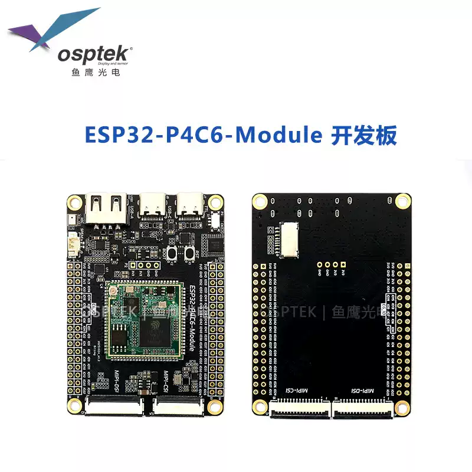
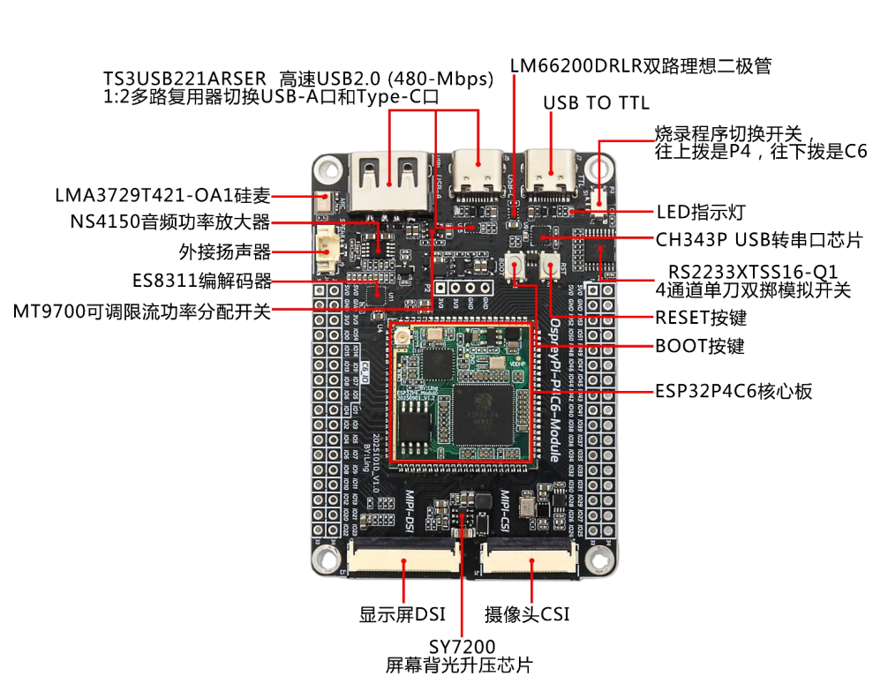
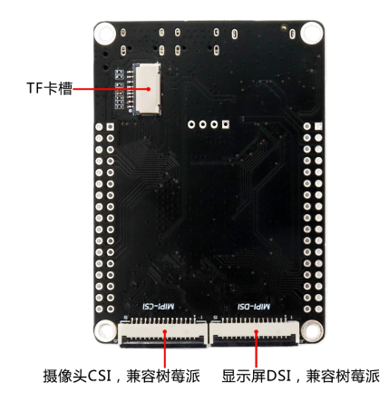
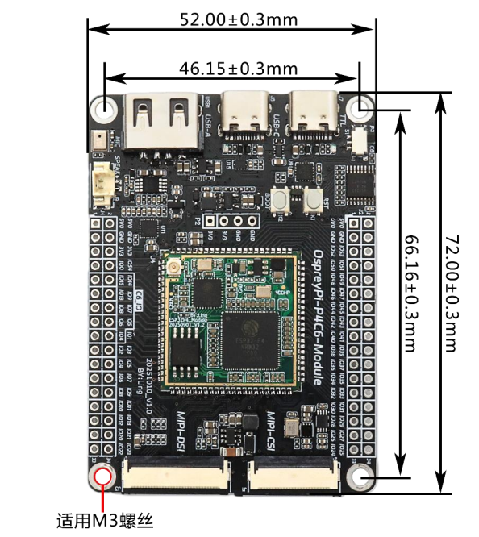
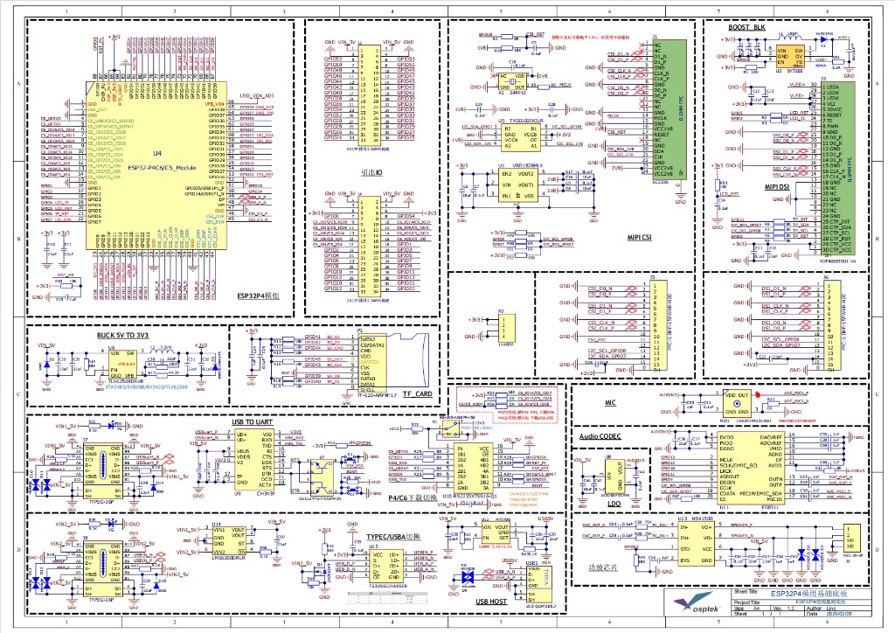

<p align="left"></p>

<h1 align="center">OSPTEK ESP32-P4C6-Module 开发板</h1>

<p align="center"><b>开箱即用 · 多功能扩展 · 全接口引出</b></p>

<p align="center"><a href="./README_EN.md">English</a> | 简体中文</p>

<p align="center">
  
  
  
  
  
</p>

<p align="center"></p>

## 目录

- [产品简介](#产品简介)
- [产品特性](#产品特性)
- [应用场景](#应用场景)
- [规格参数](#规格参数)
- [硬件资源](#硬件资源)
- [搭载核心板](#搭载核心板)
- [已适配摄像头](#已适配摄像头)
- [快速开始](#快速开始)
- [仓库结构](#仓库结构)
- [相关资料](#相关资料)
- [购买链接](#购买链接)
- [技术支持](#技术支持)
- [许可证](#许可证)

---

## 产品简介

OSPTEK ESP32-P4C6-Module 开发板是一款以 **ESP32-P4C6 核心板** 为核心的多功能开发平台。
底板在核心板基础上扩展出摄像头、显示屏、音频、USB 等外设接口与多重电源保护电路，
并通过 2×2×17 排针引出 ESP32-P4 的 55 个可编程 GPIO 及 ESP32-C6 的相关 GPIO，
省去自行设计底板的工作，可直接用于方案评估与二次开发。

核心板搭载的 ESP32-P4 内置 2 个高性能（HP）RISC-V 内核和 1 个低功耗（LP）内核，主频高达 360 MHz，
集成 JPEG 编解码器、像素处理加速器（PPA）、图像信号处理器（ISP）与 H.264 视频编码器；
配合 **ESP32-C6** 提供 Wi-Fi 6（2.4 GHz）、蓝牙 5（LE）与 IEEE 802.15.4（Zigbee / Thread）无线连接。

> 📌 当前参数基于 **ESP32-P4 芯片 v1.3 版本**。底板接口能力与 P4C5-Module 开发板同构（兼容邮票孔核心板）。

---

## 产品特性

- 🚀 **开箱即用**：核心板 + 底板一体，无需自行设计底板，上电即可评估与开发
- ⚡ **高性能双核**：ESP32-P4 双核 RISC-V 处理器，主频高达 360 MHz，16 MB Flash + 32 MB PSRAM
- 🎨 **强大多媒体**：集成 JPEG 编解码、H.264 视频编码、PPA、ISP，胜任图像与视频处理
- 📶 **无线连接**：Wi-Fi 6（2.4 GHz）、蓝牙 5（LE）、IEEE 802.15.4（Zigbee / Thread）
- 📷 **摄像头接口**：MIPI-CSI 24P 接口 + 15P 树莓派兼容接口，可直接接入 SC2336 摄像头
- 🖥️ **显示接口**：MIPI-DSI 30P 接口 + 15P 树莓派兼容接口，支持 YDP400BT001-V4 等屏幕
- 🔊 **完整音频链路**：ES8311 编解码器 + NS4150 3W D 类功放 + 板载硅麦，录音放音开箱可用
- 🔌 **丰富 USB**：2 × Type-C（数据 / 调试）+ USB-A Host，支持高速 USB 2.0 切换
- 🛠️ **免接线调试**：板载 CH343P USB 转串口，模拟开关一键切换 P4 / C6 烧录目标
- 📍 **全引脚引出**：2×2×17 排针引出 ESP32-P4 的 55 个可编程 GPIO 与 ESP32-C6 相关 GPIO
- 🛡️ **电源保护**：双路理想二极管防止电流倒灌，USB-A 输出口带过流与短路保护

---

## 应用场景

- 🖥️ HMI 人机交互
- 📷 视觉识别与图像采集
- 🎙️ 语音交互与音频处理
- 📹 视频编码与流媒体传输
- 🏠 智能家居中控面板
- 🏭 工业控制与设备监控
- 🤖 电子机器人
- 🧠 AIoT 边缘计算
- 🔌 USB 主机扩展

---

## 规格参数

### 主控与存储

| 项目     | 规格                                       |
| -------- | ------------------------------------------ |
| 核心板   | ESP32-P4C6 核心板（88 Pin 邮票孔）         |
| 主控     | 乐鑫 ESP32-P4（2 × HP RISC-V + 1 × LP 内核） |
| 主频     | 高达 360 MHz                               |
| ROM      | 128 KB HP ROM + 16 KB LP ROM               |
| SRAM     | 768 KB HP L2MEM + 32 KB LP SRAM + 8 KB TCM |
| Flash    | 16 MB 串行 NOR Flash                       |
| PSRAM    | 32 MB（ESP32-P4 片内叠封）                 |

### 无线

| 项目     | 规格                         |
| -------- | ---------------------------- |
| 无线芯片 | ESP32-C6                              |
| Wi-Fi    | Wi-Fi 6（2.4 GHz）                    |
| 蓝牙     | 蓝牙 5（LE）                          |
| 其他协议 | IEEE 802.15.4（Zigbee / Thread）      |
| 天线     | 核心板板载 IPEX-1 天线接口            |

### 摄像头与显示

| 项目           | 规格                                             |
| -------------- | ------------------------------------------------ |
| 摄像头（正面） | MIPI-CSI 24P 0.5 mm 上下接，支持 SC2336          |
| 摄像头（背面） | MIPI-CSI 15P 1.0 mm 上下接，兼容树莓派接口       |
| 显示屏（正面） | MIPI-DSI 30P 0.5 mm 上下接，支持 YDP400BT001-V4 等 |
| 显示屏（背面） | MIPI-DSI 15P 1.0 mm 上下接，兼容树莓派接口       |
| 背光驱动       | SY7200 升压恒流，为 DSI 屏幕提供恒流背光         |

### 音频

| 项目       | 规格                                     |
| ---------- | ---------------------------------------- |
| 编解码器   | ES8311（低功耗高性能单声道 Codec）       |
| 功放       | NS4150（3 W 单声道 D 类）                |
| 麦克风     | LMA3729T421-OA1 硅基麦克风（板载）       |
| 扬声器接口 | MX1.25-2P 座子                           |

### USB 与调试

| 项目      | 规格                                                  |
| --------- | ----------------------------------------------------- |
| 数据口    | Type-C × 1，高速 USB 2.0（480 Mbps）                  |
| 调试口    | Type-C × 1，板载 CH343P USB 转 UART                   |
| USB Host  | USB-A × 1                                             |
| 通道切换  | TS3USB221ARSER 1:2 多路复用，Type-C 与 USB-A 间切换   |
| 烧录切换  | 拨动开关：往上拨烧录 ESP32-P4，往下拨烧录 ESP32-C6    |
| 串口切换  | RS2233XTSS16-Q1 四通道单刀双掷模拟开关，配合拨动开关切换 |
| 按键      | RESET（复位）、BOOT（下载模式）                       |

### 电源管理

| 项目         | 规格                                                |
| ------------ | --------------------------------------------------- |
| 主电源       | 5 V 输入，TLV62569 降压至 3.3 V                     |
| 防倒灌       | LM66200DRLR 双路理想二极管（ORing 逻辑）            |
| USB-A 输出   | MT9700 可调限流功率分配开关，带过流与短路保护       |
| 辅助电源     | 板载 1.8 V / 2.8 V LDO，供摄像头等外设使用          |

### 扩展接口

| 项目      | 规格                                                     |
| --------- | -------------------------------------------------------- |
| 扩展排针  | 2 × 2×17P，2.54 mm 间距                                  |
| 引出 GPIO | ESP32-P4 的 55 个可编程 GPIO + ESP32-C6 相关 GPIO        |
| 存储扩展  | 板载 TF（microSD）卡槽                                   |

---

## 硬件资源

### 正面接口

<p align="center"></p>

核心板位于底板中央，音频、USB、调试与烧录切换电路分布在上方，四周 2×2×17 排针引出全部 GPIO；
正面 MIPI-DSI / MIPI-CSI 接口位于底部。各器件规格见 [规格参数](#规格参数)。

### 背面接口

<p align="center"></p>

背面引出两个 15P 1.0 mm 的 MIPI 接口，均兼容树莓派排线；TF 卡槽位于背面上方。

### 尺寸图

<p align="center"></p>

| 项目     | 尺寸                    |
| -------- | ----------------------- |
| 板卡尺寸 | 72.00 × 52.00 mm（±0.3 mm） |
| 安装孔距 | 66.16 × 46.15 mm（±0.3 mm） |
| 安装孔   | 4 × M3 螺丝孔           |

### 原理图

<p align="center"></p>

完整原理图 PDF 见 [docs/ESP32-P4C6-Module_Schematic_V1.3.pdf](./docs/ESP32-P4C6-Module_Schematic_V1.3.pdf)（底板兼容 P4C5 / P4C6 模组）。

### 硬件版本

| 日期     | 版本 | 更改内容 |
| -------- | ---- | -------- |
| 20251010 | V1.0 | 初始发布（丝印：OspreyPi-P4C6-Module） |

---

## 搭载核心板

本开发板搭载 **ESP32-P4C6 核心板**（`esp32-p4c6-core-board`），核心板引脚全部引出。
核心板的规格参数、引脚定义等详细资料见其独立仓库：

- GitHub：<https://github.com/osptek/esp32-p4c6-core-board>
- Gitee：<https://gitee.com/osptek/esp32-p4c6-core-board>

---

## 已适配摄像头

本开发板通过 **MIPI-CSI** 接口接入摄像头（正面 24P 0.5 mm / 背面 15P 1.0 mm 树莓派兼容）。
下列型号可与本板对接使用：

| 型号 | 接口 | GitHub | Gitee |
| ---- | ---- | ------ | ----- |
| SC2336 | MIPI CSI | [链接](https://github.com/osptek/camera-mipi-csi-sc2336) | [链接](https://gitee.com/osptek/camera-mipi-csi-sc2336) |
| OV2710 | MIPI CSI | [链接](https://github.com/osptek/camera-mipi-csi-ov2710) | [链接](https://gitee.com/osptek/camera-mipi-csi-ov2710) |

---

## 快速开始

本开发板基于 **ESP-IDF** 官方生态开发，环境安装与烧录请参考乐鑫文档：

- [ESP-IDF 快速入门 · ESP32-P4（中文）](https://docs.espressif.com/projects/esp-idf/zh_CN/latest/esp32p4/get-started/)
- [ESP-IDF Get Started · ESP32-P4（英文）](https://docs.espressif.com/projects/esp-idf/en/latest/esp32p4/get-started/)

### C6 无线协处理器固件

ESP32-P4 本身不带无线功能，Wi-Fi / 蓝牙由核心板上的 **ESP32-C6** 通过 SDIO 提供。
C6 需运行乐鑫 [ESP-Hosted-MCU](https://github.com/espressif/esp-hosted-mcu) 协处理器固件，
P4 端应用再通过 `esp_wifi_remote` + `esp_hosted` 组件使用无线功能。

下面是预编译好的 **C6 固件**（ESP-Hosted-MCU v2.12.9，SDIO 传输，ESP-IDF v5.5.4 编译），
**只能烧给 ESP32-C6，不要烧给 ESP32-P4**：

| 文件 | 烧录目标 | 烧录地址 | 说明 |
| ---- | -------- | -------- | ---- |
| [`ESP32-C6_ESP-Hosted_v2.12.9_merged_0x0.bin`](./firmware/ESP32-C6_ESP-Hosted_v2.12.9_merged_0x0.bin) | ESP32-C6 | `0x0` | 合并包（bootloader + 分区表 + 应用） |

烧录步骤：

1. 拨动开关**往下拨到 C6**。
2. USB 线连接调试口 Type-C（CH343P）。
3. 将合并包烧到 `0x0`：

   ```bash
   esptool.py --chip esp32c6 -p <串口> -b 460800 write_flash 0x0 firmware/ESP32-C6_ESP-Hosted_v2.12.9_merged_0x0.bin
   ```

4. 烧录完成后把开关**拨回 P4**，再开发、烧录 P4 端程序。

> - 合并包必须烧到 **`0x0`**，不要当成应用分区烧到 `0x10000`。
> - P4 端 `esp_hosted` 组件版本建议与 C6 固件保持一致（2.12.x），版本差异过大可能导致通信失败。

---

## 仓库结构

```text
devboard-esp32p4c6_module/
├── README.md          # 产品说明（本文档）
├── README_EN.md       # 英文说明
├── docs/              # 使用指南、原理图、摄像头/天线等 PDF 资料
├── firmware/          # C6 无线协处理器固件（ESP-Hosted，烧 C6 · 0x0）
└── images/            # README 及文档使用的图片
```

---

## 相关资料

### 本产品资料

- [ESP32-P4C6-Module 使用指南（中文，含原理图）](./docs/ESP32-P4C6-Module_UserGuide_CN_20260910.pdf)
- [ESP32-P4C6-Module User Guide（英文）](./docs/ESP32-P4C6-Module_UserGuide_EN_20260910.pdf)
- [ESP32-P4C6-Module 产品说明书（中文）](./docs/ESP32-P4C6-Module_Manual_CN.pdf)
- [ESP32-P4C6-Module 底板原理图 V1.3](./docs/ESP32-P4C6-Module_Schematic_V1.3.pdf)
- [C6 无线协处理器固件 ESP-Hosted v2.12.9（仅烧 C6 · `0x0`）](./firmware/ESP32-C6_ESP-Hosted_v2.12.9_merged_0x0.bin)

### 配套外设资料

- [SC2336 数据手册](./docs/SC2336_Datasheet_V0.7.pdf)
- [ESP32-P4-Camera 摄像头模组规格书](./docs/ESP32-P4-Camera_Spec.pdf)
- [C6 天线资料](./docs/ESP32-C6_Antenna_Spec.pdf)
- [2415 方形音腔喇叭规格书（8 Ω / 1 W，1.25 mm 间距 2P 端子）](./docs/Speaker-2415_Spec.pdf)

### 芯片资料（乐鑫官方）

- [ESP32-P4 数据手册 v1.3（中文）](https://documentation.espressif.com/esp32-p4-chip-revision-v1.3_datasheet_cn.html)
- [ESP32-P4 数据手册 v1.3（英文）](https://documentation.espressif.com/esp32-p4-chip-revision-v1.3_datasheet_en.html)
- [ESP32-P4 技术参考手册 v1.3（中文）](https://documentation.espressif.com/esp32-p4-chip-revision-v1.3_technical_reference_manual_cn.pdf)
- [ESP32-P4 技术参考手册 v1.3（英文）](https://documentation.espressif.com/esp32-p4-chip-revision-v1.3_technical_reference_manual_en.pdf)
- [ESP32-P4 产品主页（中文）](https://www.espressif.com/zh-hans/producttype/esp32-p4)
- [ESP32-P4 产品主页（英文）](https://www.espressif.com/en/producttype/esp32-p4)
- [ESP32-C6 数据手册（中文）](https://documentation.espressif.com/esp32-c6_datasheet_cn.html)
- [ESP32-C6 数据手册（英文）](https://documentation.espressif.com/esp32-c6_datasheet_en.html)
- [ESP32-C6 产品主页（中文）](https://www.espressif.com/zh-hans/products/socs/esp32-c6)
- [ESP32-C6 产品主页（英文）](https://www.espressif.com/en/products/socs/esp32-c6)

### 开发指南

- [ESP-IDF 编程指南 · ESP32-P4（中文）](https://docs.espressif.com/projects/esp-idf/zh_CN/latest/esp32p4/index.html)
- [ESP-IDF 编程指南 · ESP32-P4（英文）](https://docs.espressif.com/projects/esp-idf/en/latest/esp32p4/index.html)
- [ESP-IDF 快速入门 · ESP32-P4（中文）](https://docs.espressif.com/projects/esp-idf/zh_CN/latest/esp32p4/get-started/)
- [ESP-IDF 快速入门 · ESP32-P4（英文）](https://docs.espressif.com/projects/esp-idf/en/latest/esp32p4/get-started/)

---

## 购买链接

<p align="center">
  <a href="https://shop110742373.taobao.com/"></a>
  &nbsp;&nbsp;
  <a href="https://www.aliexpress.com/store/1105701619"></a>
</p>

**国内（淘宝）**

- 店铺：[鱼鹰光电工厂店](https://shop110742373.taobao.com/)

**海外（AliExpress）**

- 店铺：[OSPTEK Official Store](https://www.aliexpress.com/store/1105701619)

---

## 技术支持

如有技术问题或合作需求，欢迎通过以下方式联系我们：

- 📧 技术支持 / 产品咨询：<luyu@osptek.com>
- 🐧 QQ 技术交流群：**985881096**
- 🌐 公司官网：<https://osptek.com/>
- 有任何问题，都可以在本仓库 Issues 中提问

## 许可证

- 本仓库资料（文档、原理图、图片等）：[CC BY-NC-SA 4.0](./LICENSE)，转载或修改请注明出处，不得用于商业用途，如需商业授权请联系我们
- `firmware/` 中的 C6 固件基于乐鑫 ESP-Hosted-MCU 编译，沿用其 Apache-2.0 许可证
- 第三方资料（如 SC2336 数据手册）版权归原厂所有

---

<p align="center"><sub>© 2026 OSPTEK 鱼鹰光电 · 本仓库资料采用 CC BY-NC-SA 4.0 许可</sub></p>
