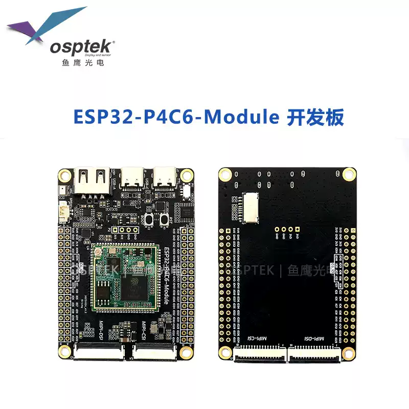
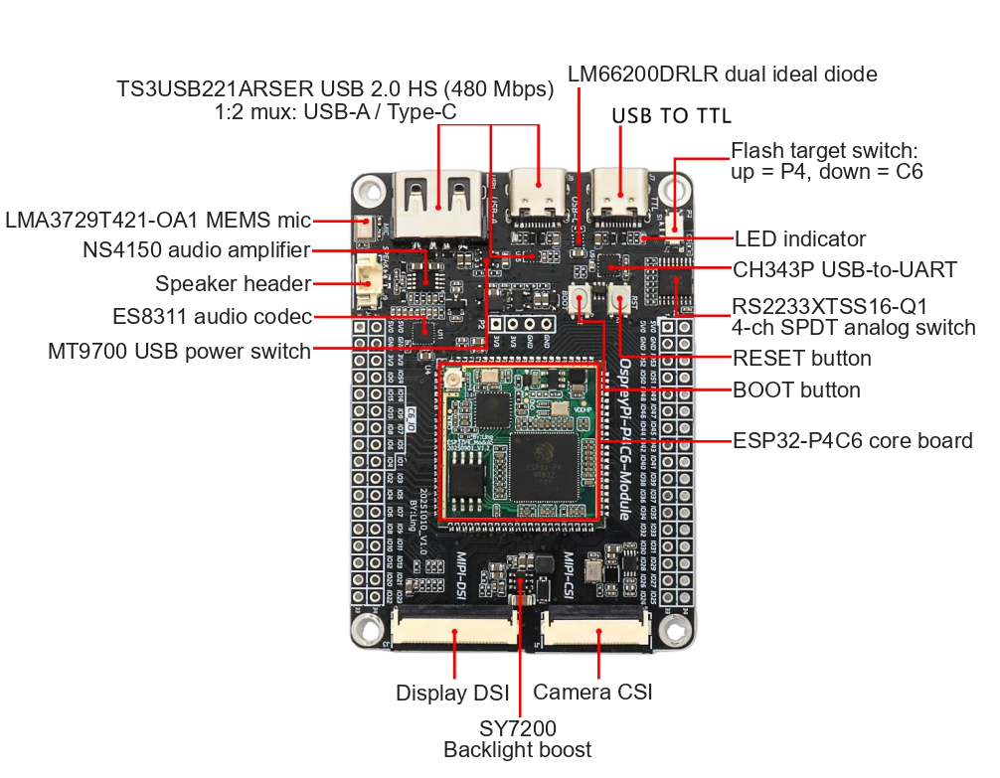
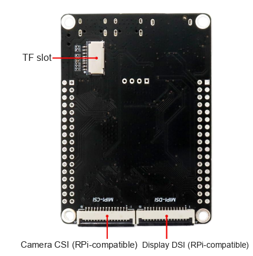
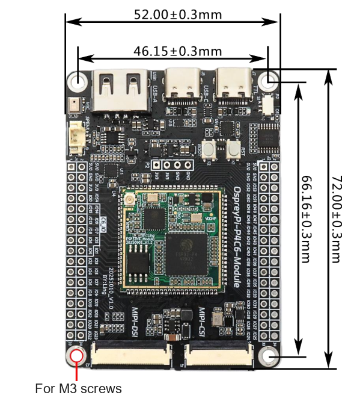
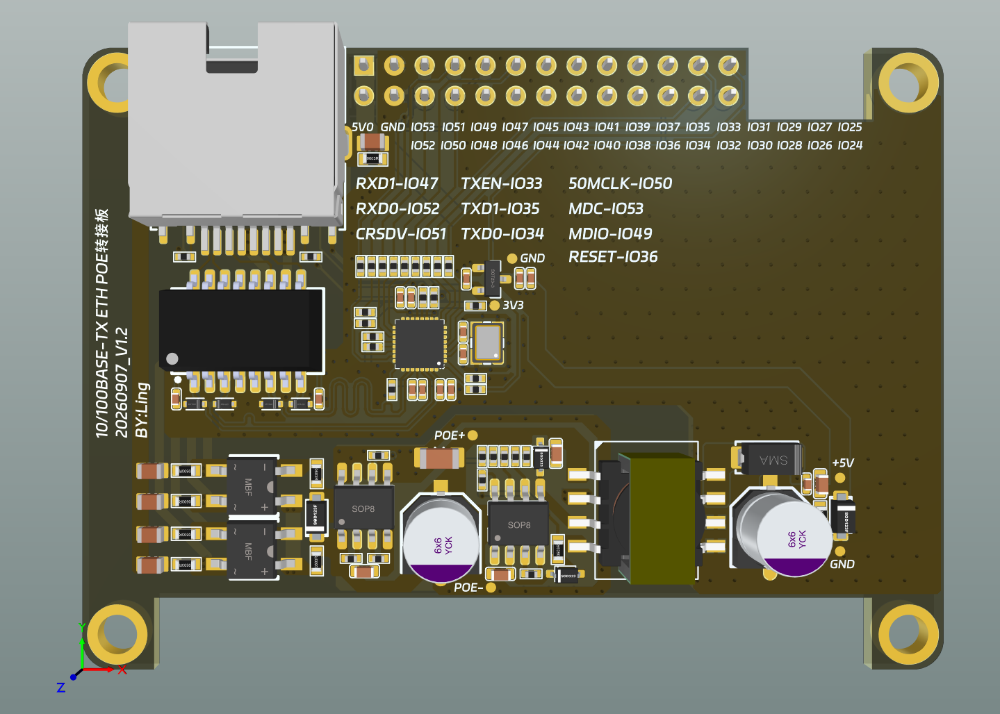
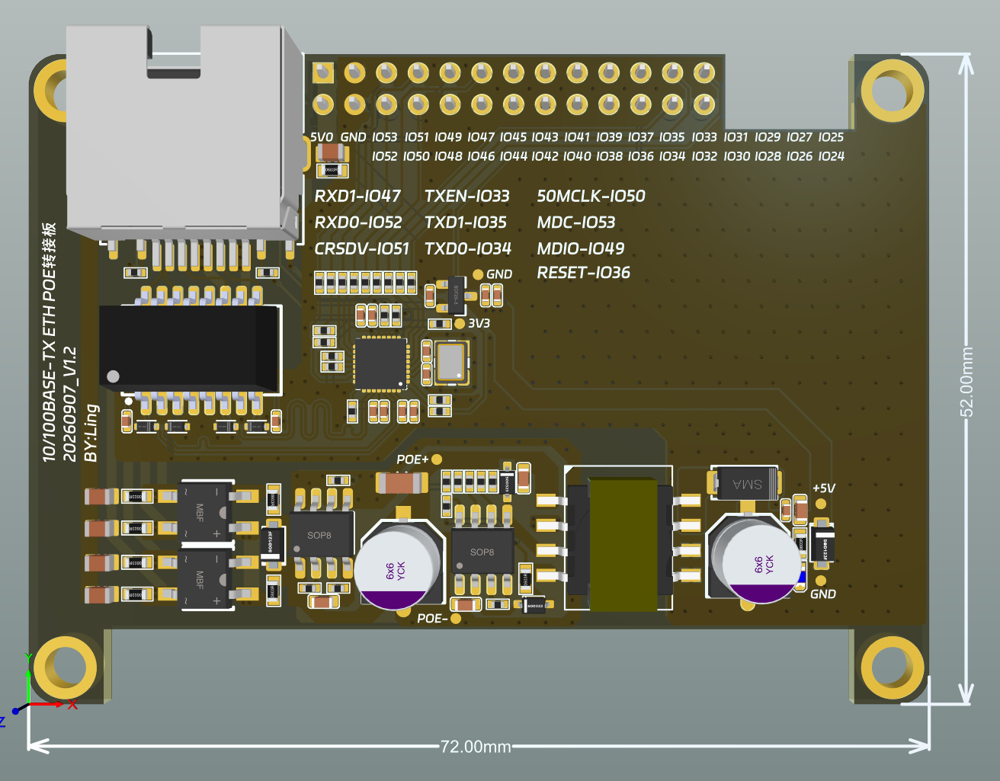
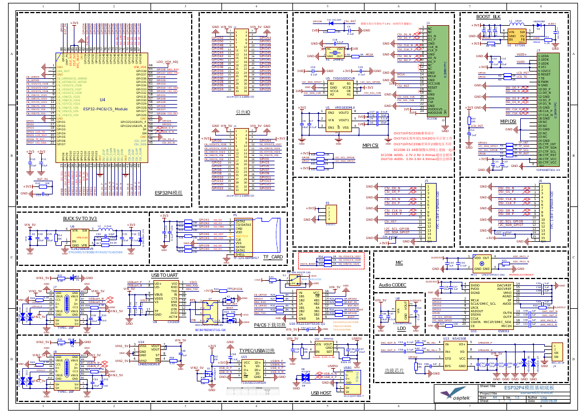

<p align="left"></p>

<h1 align="center">OSPTEK ESP32-P4C6-Module Dev Board</h1>

<p align="center"><b>Ready to Use · Rich Expansion · Full I/O Breakout</b></p>

<p align="center">English | <a href="./README.md">简体中文</a></p>

<p align="center">
  
  
  
  
  
</p>

<p align="center"></p>

## Contents

- [Overview](#overview)
- [Features](#features)
- [Applications](#applications)
- [Specifications](#specifications)
- [Hardware Resources](#hardware-resources)
- [Core Board](#core-board)
- [Compatible Cameras](#compatible-cameras)
- [Get Started](#get-started)
- [Repository Structure](#repository-structure)
- [Documentation](#documentation)
- [Where to Buy](#where-to-buy)
- [Support](#support)
- [License](#license)

---

## Overview

The OSPTEK ESP32-P4C6-Module Dev Board is a multi-function development platform built around the
**ESP32-P4C6 core board**. The carrier adds camera, display, audio, USB and power-protection circuits,
and breaks out ESP32-P4's 55 programmable GPIOs plus ESP32-C6 GPIOs via 2×2×17 headers—ready for
evaluation and secondary development without designing your own carrier.

The onboard ESP32-P4 integrates two high-performance (HP) RISC-V cores and one low-power (LP) core,
up to 360 MHz, with JPEG codec, PPA, ISP and H.264 video encoder. **ESP32-C6** provides Wi-Fi 6
(2.4 GHz), Bluetooth 5 (LE) and IEEE 802.15.4 (Zigbee / Thread) connectivity.

> 📌 Specifications below are based on the **ESP32-P4 chip revision v1.3**. Carrier I/O is isomorphic
> with the P4C5-Module Dev Board (compatible stamp-hole core boards).

---

## Features

- 🚀 **Ready to Use**: core board + carrier in one; power up and start evaluating
- ⚡ **High-Performance Dual-Core**: ESP32-P4 dual-core RISC-V up to 360 MHz, 16 MB Flash + 32 MB PSRAM
- 🎨 **Rich Multimedia**: JPEG codec, H.264 encoding, PPA, ISP for image & video
- 📶 **Wireless Connectivity**: Wi-Fi 6 (2.4 GHz), Bluetooth 5 (LE), IEEE 802.15.4 (Zigbee / Thread)
- 📷 **Camera Interface**: MIPI-CSI 24P + 15P Raspberry Pi–compatible connector; SC2336 ready
- 🖥️ **Display Interface**: MIPI-DSI 30P + 15P Raspberry Pi–compatible connector; YDP400BT001-V4 and more
- 🔊 **Full Audio Path**: ES8311 codec + NS4150 3 W Class-D amp + onboard silicon mic
- 🔌 **Rich USB**: 2 × Type-C (data / debug) + USB-A Host with high-speed USB 2.0 mux
- 🛠️ **Wire-free Debug**: onboard CH343P USB-UART; switch selects P4 / C6 flash target
- 📍 **Full Pin Breakout**: 2×2×17 headers for ESP32-P4 GPIOs and ESP32-C6 GPIOs
- 🛡️ **Power Protection**: dual ideal diodes (ORing); USB-A output with OCP / short protection

---

## Applications

- 🖥️ HMI
- 📷 Vision & image capture
- 🎙️ Voice & audio processing
- 📹 Video encode & streaming
- 🏠 Smart-home control panels
- 🏭 Industrial control & monitoring
- 🤖 Robotics
- 🧠 AIoT edge computing
- 🔌 USB host expansion

---

## Specifications

### MCU & Memory

| Item      | Specification                                      |
| --------- | -------------------------------------------------- |
| Core Board | ESP32-P4C6 core board (88-pin stamp-hole)         |
| Main MCU  | Espressif ESP32-P4 (2 × HP RISC-V + 1 × LP)        |
| Clock     | Up to 360 MHz                                      |
| ROM       | 128 KB HP ROM + 16 KB LP ROM                       |
| SRAM      | 768 KB HP L2MEM + 32 KB LP SRAM + 8 KB TCM         |
| Flash     | 16 MB serial NOR Flash                             |
| PSRAM     | 32 MB (in-package with ESP32-P4)                   |

### Wireless

| Item          | Specification                              |
| ------------- | ------------------------------------------ |
| Wireless Chip | ESP32-C6                                   |
| Wi-Fi         | Wi-Fi 6 (2.4 GHz)                          |
| Bluetooth     | Bluetooth 5 (LE)                           |
| Other         | IEEE 802.15.4 (Zigbee / Thread)            |
| Antenna       | Core-board onboard IPEX-1 connector        |

### Camera & Display

| Item                 | Specification                                              |
| -------------------- | ---------------------------------------------------------- |
| Camera (front)       | MIPI-CSI 24P 0.5 mm, SC2336 supported                      |
| Camera (back)        | MIPI-CSI 15P 1.0 mm, Raspberry Pi compatible               |
| Display (front)      | MIPI-DSI 30P 0.5 mm, YDP400BT001-V4 and more               |
| Display (back)       | MIPI-DSI 15P 1.0 mm, Raspberry Pi compatible               |
| Backlight driver     | SY7200 boost constant-current for DSI panels               |

### Audio

| Item            | Specification                          |
| --------------- | -------------------------------------- |
| Codec           | ES8311 (mono)                          |
| Amplifier       | NS4150 (3 W mono Class-D)              |
| Microphone      | LMA3729T421-OA1 silicon mic (onboard)  |
| Speaker connector | MX1.25-2P                            |

### USB & Debug

| Item           | Specification                                                       |
| -------------- | ------------------------------------------------------------------- |
| Data port      | Type-C × 1, High-Speed USB 2.0 (480 Mbps)                           |
| Debug port     | Type-C × 1, onboard CH343P USB-UART                                 |
| USB Host       | USB-A × 1                                                           |
| Path mux       | TS3USB221ARSER 1:2 between Type-C and USB-A                         |
| Flash target   | Slide switch + RS2233XTSS16-Q1: up = ESP32-P4, down = ESP32-C6      |
| Buttons        | RESET (reset), BOOT (download mode)                                 |

### Power

| Item           | Specification                                                 |
| -------------- | ------------------------------------------------------------- |
| Main supply    | 5 V in, TLV62569 buck to 3.3 V                                |
| Reverse / ORing | LM66200DRLR dual ideal diodes                                |
| USB-A output   | MT9700 adjustable current-limit switch with OCP / short protect |
| Aux rails      | Onboard 1.8 V / 2.8 V LDO for camera and peripherals          |

### Expansion

| Item           | Specification                                              |
| -------------- | ---------------------------------------------------------- |
| Headers        | 2 × 2×17P, 2.54 mm pitch                                   |
| GPIO breakout  | ESP32-P4 55 programmable GPIOs + ESP32-C6 GPIOs            |
| Storage        | Onboard microSD (TF) slot                                  |

---

## Hardware Resources

### Front Interfaces

<p align="center"></p>

The core board sits in the center; audio, USB, debug and flash-switch circuits are along the top, and
2×2×17 headers around the edge break out all GPIOs. The front MIPI-DSI / MIPI-CSI connectors are at the
bottom. See [Specifications](#specifications) for component details.

### Back Interfaces

<p align="center"></p>

Two 15P 1.0 mm MIPI connectors on the back are Raspberry Pi cable compatible; the microSD (TF) slot is on the upper back.

### Dimensions

<p align="center"></p>

| Item            | Size                              |
| --------------- | --------------------------------- |
| Board size      | 72.00 × 52.00 mm (±0.3 mm)        |
| Mounting pitch  | 66.16 × 46.15 mm (±0.3 mm)        |
| Mounting holes  | 4 × M3                            |

### PoE Ethernet Adapter

An optional 10/100BASE-TX Ethernet + PoE adapter board (V1.2). It plugs onto the dev board headers via a
2×13P 2.54 mm female header, giving the ESP32-P4 RMII wired networking and letting a PoE switch power the
board over the network cable.

<p align="center"></p>

| Item          | Specification                                                              |
| ------------- | -------------------------------------------------------------------------- |
| Ethernet PHY  | IP101GRI, 10/100BASE-TX, RMII, 25 MHz crystal                              |
| Port          | RJ45 with Link / Speed LEDs                                                |
| PoE PD        | TPS2378 (IEEE 802.3af PD) + XC7010 isolated flyback, +5 V out to the board |
| PHY Power     | XC6206 LDO, +5 V → 3.3 V                                                   |
| Board Size    | 72.00 × 52.00 mm, 4 mounting holes matching the dev board                  |
| Connector     | 2×13P 2.54 mm female header                                                |

RMII pin mapping (ESP32-P4 GPIO):

| Signal   | GPIO | Signal  | GPIO | Signal     | GPIO |
| -------- | ---- | ------- | ---- | ---------- | ---- |
| RXD0     | 52   | TXD0    | 34   | 50M_CLK    | 50   |
| RXD1     | 47   | TXD1    | 35   | MDC        | 53   |
| CRS_DV   | 51   | TX_EN   | 33   | MDIO       | 49   |
|          |      |         |      | PHY_RESET  | 36   |

<p align="center"></p>

| File | Description |
| ---- | ----------- |
| [PoE Ethernet adapter schematic V1.2](./docs/ESP32-P4C6-Module_PoE-Ethernet-Adapter_Schematic_V1.2.pdf) | Schematic PDF |
| [PoE Ethernet adapter STEP V1.2](./docs/ESP32-P4C6-Module_PoE-Ethernet-Adapter_V1.2.step) | PCBA 3D model |

### Schematic

<p align="center"></p>

Full schematic PDF: [docs/ESP32-P4C6-Module_Schematic_V1.5.pdf](./docs/ESP32-P4C6-Module_Schematic_V1.5.pdf) (carrier compatible with P4C5 / P4C6 modules).

### Hardware Revisions

| Date     | Rev  | Notes                                              |
| -------- | ---- | -------------------------------------------------- |
| 20251010 | V1.0 | Initial release (silkscreen: OspreyPi-P4C6-Module) |
| 20260901 | V1.5 | Added configurable 0 Ω C5/C6 BOOT-selection links |

---

## Core Board

This board carries the **ESP32-P4C6 core board** (`esp32-p4c6-core-board`) with full pin breakout.
Core-board specs and pin definitions:

- GitHub: <https://github.com/osptek/esp32-p4c6-core-board>
- Gitee: <https://gitee.com/osptek/esp32-p4c6-core-board>

---

## Compatible Cameras

Via **MIPI-CSI** (front 24P 0.5 mm / back 15P 1.0 mm Pi-compatible).

| Model | Interface | GitHub | Gitee |
| ----- | --------- | ------ | ----- |
| SC2336 | MIPI CSI | [link](https://github.com/osptek/camera-mipi-csi-sc2336) | [link](https://gitee.com/osptek/camera-mipi-csi-sc2336) |
| OV2710 | MIPI CSI | [link](https://github.com/osptek/camera-mipi-csi-ov2710) | [link](https://gitee.com/osptek/camera-mipi-csi-ov2710) |

---

## Get Started

Built on the official **ESP-IDF** ecosystem:

- [ESP-IDF Get Started · ESP32-P4](https://docs.espressif.com/projects/esp-idf/en/latest/esp32p4/get-started/)
- [ESP-IDF 快速入门 · ESP32-P4（中文）](https://docs.espressif.com/projects/esp-idf/zh_CN/latest/esp32p4/get-started/)

### C6 Wireless Co-processor Firmware

ESP32-P4 has no built-in radio. Wi-Fi / Bluetooth is provided over SDIO by the **ESP32-C6** on the core board.
The C6 runs Espressif's [ESP-Hosted-MCU](https://github.com/espressif/esp-hosted-mcu) co-processor firmware,
and P4 applications use wireless through the `esp_wifi_remote` + `esp_hosted` components.

Below is the prebuilt **C6 firmware** (ESP-Hosted-MCU v2.12.9, SDIO transport, built with ESP-IDF v5.5.4).
**Flash it to ESP32-C6 only — never to ESP32-P4:**

| File | Target | Address | Notes |
| ---- | ------ | ------- | ----- |
| [`ESP32-C6_ESP-Hosted_v2.12.9_merged_0x0.bin`](./firmware/ESP32-C6_ESP-Hosted_v2.12.9_merged_0x0.bin) | ESP32-C6 | `0x0` | Merged image (bootloader + partition table + app) |

Steps:

1. Set the slide switch **down to C6**.
2. Connect the debug Type-C port (CH343P) to your computer.
3. Flash the merged image at `0x0`:

   ```bash
   esptool.py --chip esp32c6 -p <PORT> -b 460800 write_flash 0x0 firmware/ESP32-C6_ESP-Hosted_v2.12.9_merged_0x0.bin
   ```

4. When done, set the switch **back to P4** to develop and flash the P4 application.

> - The merged image must be flashed at **`0x0`**, not at the app offset `0x10000`.
> - Keep the P4-side `esp_hosted` component version in line with the C6 firmware (2.12.x); a large version gap may break host–slave communication.

---

## Repository Structure

```text
devboard-esp32p4c6_module/
├── README.md          # Product documentation (Chinese)
├── README_EN.md       # Product documentation (English, this file)
├── docs/              # user guides, schematics, PoE adapter, camera/antenna files
├── firmware/          # C6 wireless co-processor firmware (ESP-Hosted, flash C6 @ 0x0)
└── images/            # Images used in README & docs
```

---

## Documentation

### This Product

- [ESP32-P4C6-Module User Guide (EN)](./docs/ESP32-P4C6-Module_UserGuide_EN_20260910.pdf)
- [ESP32-P4C6-Module 使用指南 (CN, includes schematic)](./docs/ESP32-P4C6-Module_UserGuide_CN_20260910.pdf)
- [ESP32-P4C6-Module Product Manual (CN)](./docs/ESP32-P4C6-Module_Manual_CN.pdf)
- [ESP32-P4C6-Module carrier schematic V1.5](./docs/ESP32-P4C6-Module_Schematic_V1.5.pdf)
- [PoE Ethernet adapter schematic V1.2](./docs/ESP32-P4C6-Module_PoE-Ethernet-Adapter_Schematic_V1.2.pdf)
- [PoE Ethernet adapter STEP V1.2](./docs/ESP32-P4C6-Module_PoE-Ethernet-Adapter_V1.2.step)
- [C6 wireless co-processor firmware, ESP-Hosted v2.12.9 (C6 only, `0x0`)](./firmware/ESP32-C6_ESP-Hosted_v2.12.9_merged_0x0.bin)

### Companion Peripherals

- [SC2336 datasheet](./docs/SC2336_Datasheet_V0.7.pdf)
- [ESP32-P4-Camera module specification](./docs/ESP32-P4-Camera_Spec.pdf)
- [C6 antenna specification](./docs/ESP32-C6_Antenna_Spec.pdf)
- [2415 cavity speaker specification (8 Ω / 1 W, 1.25 mm pitch 2P connector)](./docs/Speaker-2415_Spec.pdf)

### Chip Documentation (Espressif)

- [ESP32-P4 Datasheet v1.3](https://documentation.espressif.com/esp32-p4-chip-revision-v1.3_datasheet_en.html)
- [ESP32-P4 Technical Reference Manual v1.3](https://documentation.espressif.com/esp32-p4-chip-revision-v1.3_technical_reference_manual_en.pdf)
- [ESP32-P4 Product Page](https://www.espressif.com/en/producttype/esp32-p4)
- [ESP32-C6 Datasheet](https://documentation.espressif.com/esp32-c6_datasheet_en.html)
- [ESP32-C6 Product Page](https://www.espressif.com/en/products/socs/esp32-c6)

### Development Guides

- [ESP-IDF Programming Guide · ESP32-P4](https://docs.espressif.com/projects/esp-idf/en/latest/esp32p4/index.html)
- [ESP-IDF Get Started · ESP32-P4](https://docs.espressif.com/projects/esp-idf/en/latest/esp32p4/get-started/)

---

## Where to Buy

<p align="center">
  <a href="https://www.aliexpress.com/store/1105701619"></a>
  &nbsp;&nbsp;
  <a href="https://shop110742373.taobao.com/"></a>
</p>

**International (AliExpress)**

- Store: [OSPTEK Official Store](https://www.aliexpress.com/store/1105701619)

**China (Taobao)**

- Store: [鱼鹰光电工厂店](https://shop110742373.taobao.com/)

---

## Support

For technical questions or business inquiries, feel free to contact us:

- 📧 Technical Support / Sales: <luyu@osptek.com>
- 🐧 QQ Technical Group: **985881096**
- 🌐 Website: <https://osptek.com/>
- Feel free to open an Issue in this repository if you have any questions

## License

- Repository materials (docs, schematics, images, etc.): [CC BY-NC-SA 4.0](./LICENSE). Credit OSPTEK when sharing or adapting; non-commercial use only. Contact us for commercial licensing.
- The C6 firmware in `firmware/` is built from Espressif ESP-Hosted-MCU and remains under Apache-2.0.
- Third-party materials (e.g. the SC2336 datasheet) remain the property of their respective owners.

---

<p align="center"><sub>© 2026 OSPTEK · Licensed under CC BY-NC-SA 4.0</sub></p>
